# autostream dial: Using the Screen

This guide covers the optional dial screen: what each page shows, what
happens when you tap it, and how the pages fit together. It doesn't cover
setup or configuration; see [Getting Started](GETTING-STARTED.md) for
that, and the [Build Guide](BUILD-GUIDE.md) for fitting the screen and
touch panel in the first place. It covers the small SPI screens. A dial
with a full-size HDMI or DSI touchscreen has its own page: see
[HD dial](HD-DIAL.md).

The screen comes in two sizes. A small (physically tiny) panel runs a
simplified "compact" layout: a plain 2x2 grid of controls with no text
labels beyond what's strictly needed. A larger panel runs the full "rich"
layout, with an appliance name, artist and track text, and a few extra
pages the compact layout doesn't have room for. Screenshots below are
marked rich or compact; where a page looks the same either way, only one is
shown.

Everything in this guide needs the touch panel to interact with. A screen
fitted without a touch panel still shows the same pages, but taps do
nothing: turn the dial's rotary control to change volume, as before.

`[ ]` marks a couple of points I couldn't confirm from the code and have
flagged rather than guessed.

## Idle screen

Nothing playing, on any autostream appliance the dial can see, shows the
plain autostream logo:

*Rich idle screen: logo and Wi-Fi icon (top left).*

*Compact idle screen: the same logo and icon, just tighter.*

Two small corner controls sit on the idle screen, rich or compact:

- **Top left, the Wi-Fi icon** shows the dial's own network status (see
  below) and opens the [Info page](#info-page).
- **Top right, the bell**, when the dial has warnings. It is not there
  otherwise. See [The warning bell](#the-warning-bell).

Tapping anywhere else on the idle screen opens the replay picker, but only
if a held recording is actually available to replay; otherwise the tap
does nothing. See [Repeat and replay](#repeat-and-replay).

## Wi-Fi status icon

The Wi-Fi icon in the top-left corner has four looks:

*Connected: steady bars, one lit for each notch of signal strength.*

The icon flashes when the link is down, alternating every second or so
between a dimmed grey glyph and one of two other looks, depending on what
kind of "down" it is:

*The grey half of the flash, shown either way while the link is down.*

*Lost connection: the flash's other half turns red. This means the dial
was connected at some point since it last started, and has since dropped
off the network.*

*Still connecting: the flash's other half shows nothing at all, rather
than red. This means the dial hasn't connected since it started up (for
example, straight after a reboot), so dropping to red would wrongly
suggest something has gone wrong, when it may simply not have joined yet.*

A tap on the icon opens the [Info page](#info-page), whatever it is showing.
When the dial has been connected and then loses the link, it also raises a
No WiFi warning in the [bell](#no-wifi-and-restart) after a few seconds. A
dial that is still connecting for the first time raises none, so a reboot
does not look like a fault.

## Starting up

The very first frame the screen shows at boot, before the dial has even
finished starting its own backend:

*Rich panel.*

*Compact panel: identical message, smaller frame.*

This clears itself automatically once the dial's first status check
completes, replaced by the idle screen or whatever is playing.

## Now playing and touch controls

While something is playing, the appliance name, artist, track and volume
show at the top and bottom of the artwork. Artwork, artist and track shown
here are stand-ins, not a real recording:

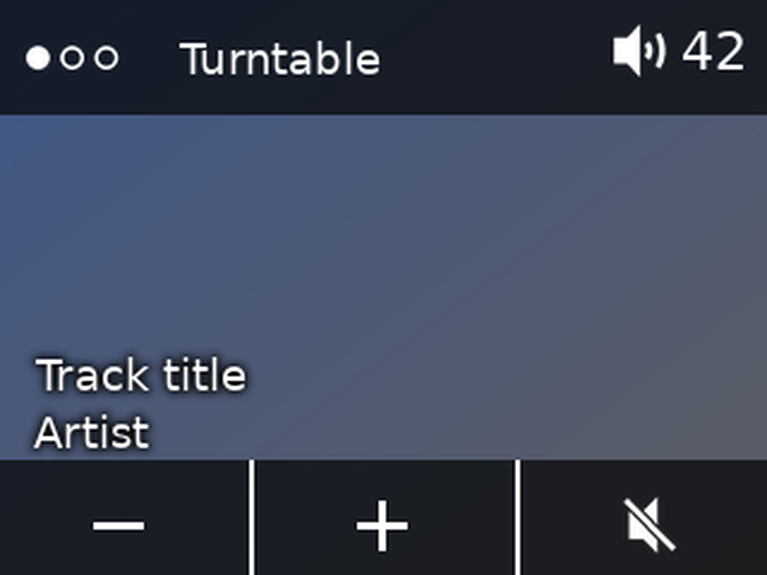

*Rich now-playing screen. Top: page dots, appliance name, speaker icon and
volume. Bottom: minus, plus, mute.*

The top and bottom bands here are two different tap targets that happen to
both show a speaker icon, easy to mix up:

- The **top-right speaker icon and volume number** open the
  [outputs list](#per-output-control) (rich panels only, see below).
- The **bell**, when the dial has warnings, sits in the top band beside the
  volume (on a compact panel, beside the page dots). Tap it to read them; see
  [The warning bell](#the-warning-bell).
- The **bottom-right mute button** toggles mute. It always shows the same
  crossed-speaker icon; when muted, the whole button lights up solid so you
  can see the state at a glance, rather than the icon itself changing.

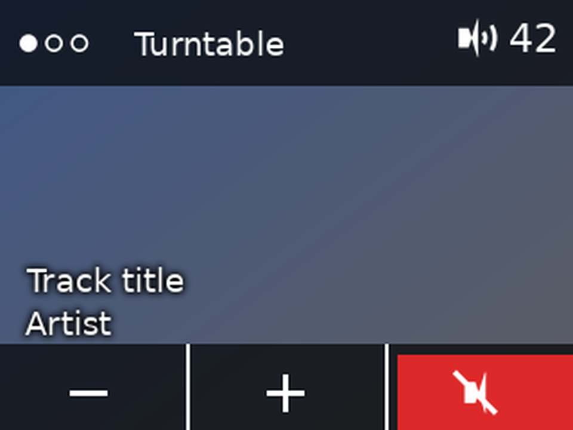

*Muted: the mute cell (bottom right) fills solid. Nothing else changes:
the appliance is still selected and playing, just silent.*

Tapping the artwork itself (the middle of the screen, between the two
bands) hides both bands for about six seconds, so you can see the artwork
without anything overlaid. Tap anywhere on the screen to bring the bands
back before the six seconds is up. If the dial has warnings, a bell on a dark
disc stays in the top-right corner of the bare artwork, and a tap on it opens
its card at once.

Other taps on this screen:

- The **appliance name** (top left, next to the page dots) opens the
  [appliance selector](#appliance-selector), rich panels only.
- **Minus** and **plus** (bottom left and centre) step the volume down or
  up by the configured step size. Hold either down to repeat.

The screen also follows changes made elsewhere. If you switch a speaker,
change a volume, mute, turn repeat on or off, or adjust the equaliser on
another dial or in the appliance's web page, this screen shows it within a
second or so, and so does a new track, with its artist and artwork. A dial
that misses the news, for example because it was out of reach for a moment,
catches up within a few seconds on its own.

### Compact controls

On a compact panel, the now-playing screen has no text at all, just
artwork behind a 2x2 grid of controls, and even that grid starts hidden.
Tap anywhere to reveal it for about six seconds:

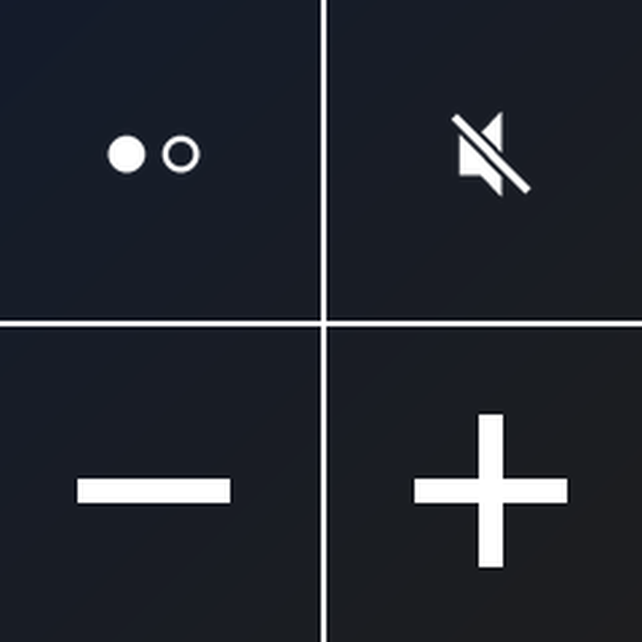

*Compact controls, revealed. Top left: page dots. Top right: mute. Bottom:
minus, plus.*

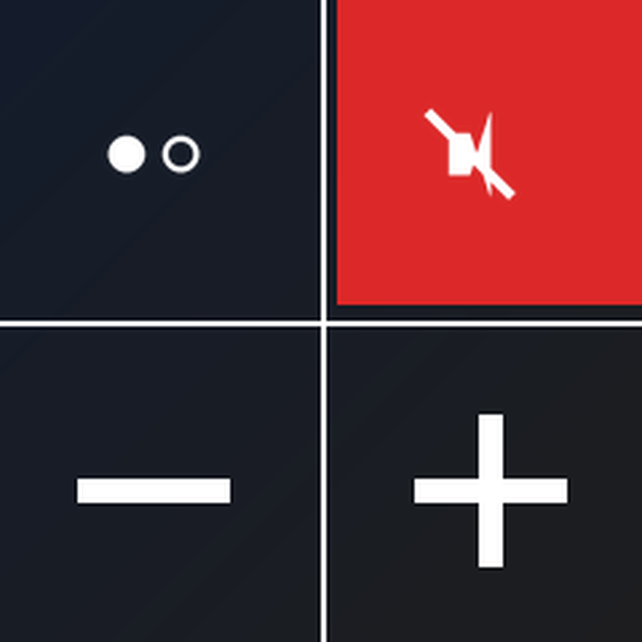

*Muted: the top-right cell inverts to a solid light background with a dark
glyph, the same "always the same icon, the cell shows the state" rule as
the rich mute button.*

There's no appliance name and no way to open the outputs list from a
compact panel; see the notes on each of those sections below.

## Page dots

The two or three small dots next to the appliance name (or, on compact, on
their own in the top-left cell) show which of up to three pages is open,
and let you move between them:

- **Main** (now playing): the left dot.
- **Repeat**: the middle dot, only present if a held recording is
  available to arm or replay.
- **EQ**: the third dot, only present on rich and larger panels, and only
  if the currently-followed appliance supports bass/treble control. Never
  appears on compact panels at all, even if the appliance supports it.

Tapping the dots cycles to the next available page, skipping any page with
nothing to show, and wrapping back to main. Leaving the repeat or EQ page
this way brings you back to the now-playing screen with its volume overlay
showing, rather than bare artwork.

## Appliance selector

Rich panels only. Tapping the appliance name opens a list of every
appliance the dial can see and control:

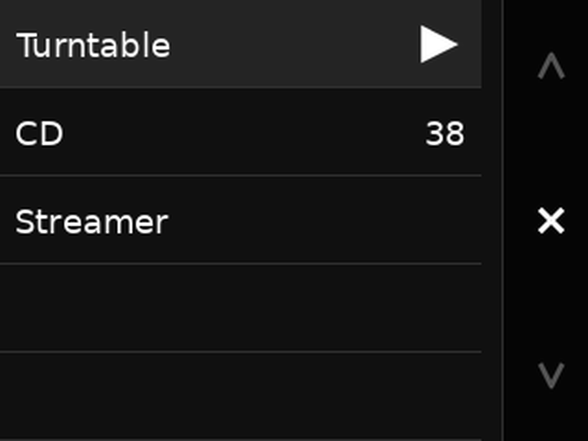

*The currently-playing row (highlighted) shows a play glyph; other rows
show their own volume if idle, or nothing if unreachable.*

Tap a row to switch the dial's focus to that appliance. This works whether
it's currently playing or idle. Tap the X to close the list without
changing anything. The chevrons (or, on some panels, a side rail) page
through the list if there are more appliances than fit on one screen.

Appliances that have authorised this dial are listed first, then those that
have not. Within each group, appliances that are playing come before idle ones,
then they are in name order.

An appliance that has not authorised this dial is listed too, dimmed, with
**Not authorised** in place of the playing glyph or volume. Tapping that row
does not switch to it. Instead it opens a short full-screen hint, "Allow this
dial in <appliance name>'s web UI (Setup, Dials)", and going back from the
hint returns to the list. To fix it, open that appliance's web page, go to
Setup, Dials, find this dial's card and turn on **Allow dial to control this
appliance** (see [Getting Started](GETTING-STARTED.md#authorizing-the-dial)).
The row returns to normal once the appliance has accepted the dial and the
dial has next checked in with it.

The screen goes to sleep after 5 minutes with nothing playing on any
appliance the dial may control. It wakes when one of those appliances starts
playing, or when you touch it. A touch on the sleeping screen only wakes it and
never presses anything; touch again to use the control under your finger.

An appliance that has not authorised the dial no longer wakes the screen.
Playing on it does not turn a sleeping panel on, does not keep an idle panel
awake, and does not put a "Playing" view on screen. The dial does not send it
volume or mute either. An appliance that has not answered either way yet is
treated as usable until it refuses.

Compact panels have no name button and so no way to open this list: a
compact dial simply follows whichever appliance is currently reporting
playback.

## Repeat and replay

The repeat feature holds a recording so it can be replayed later. Before
one is running or held, the repeat page doesn't exist at all: the page
dots skip straight over it. Once a recording is available, it has two
layouts depending on state.

### Enable

Shown while a live source is recording, pending, or idle with repeat
switched on:

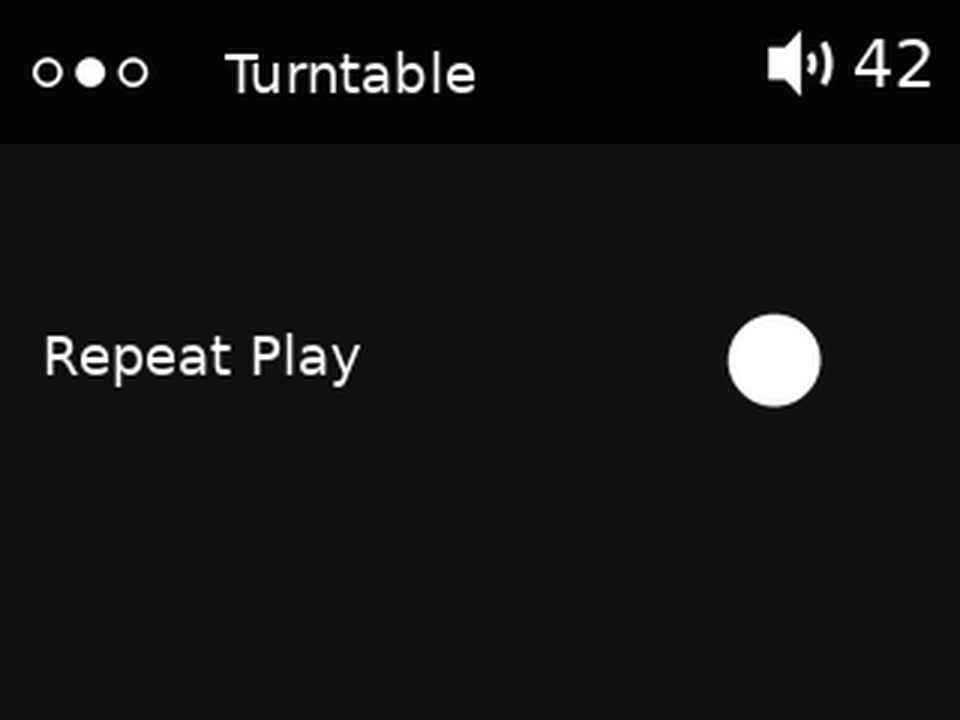

*Rich: the toggle row. A solid dot means armed; a hollow ring means
disarmed. Tap the row to flip it.*

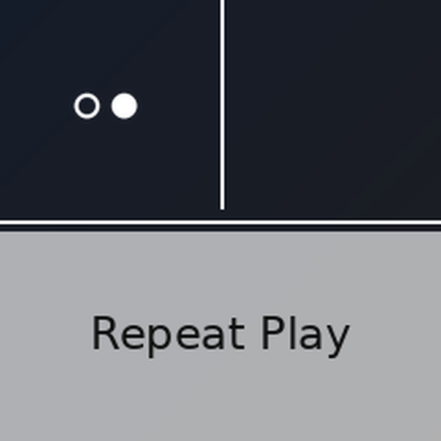

*Compact: the same toggle spans the whole bottom row, with the dots cell
top left to back out.*

### Replaying

Shown once a held recording is running (or paused in Hold, ready to
start):

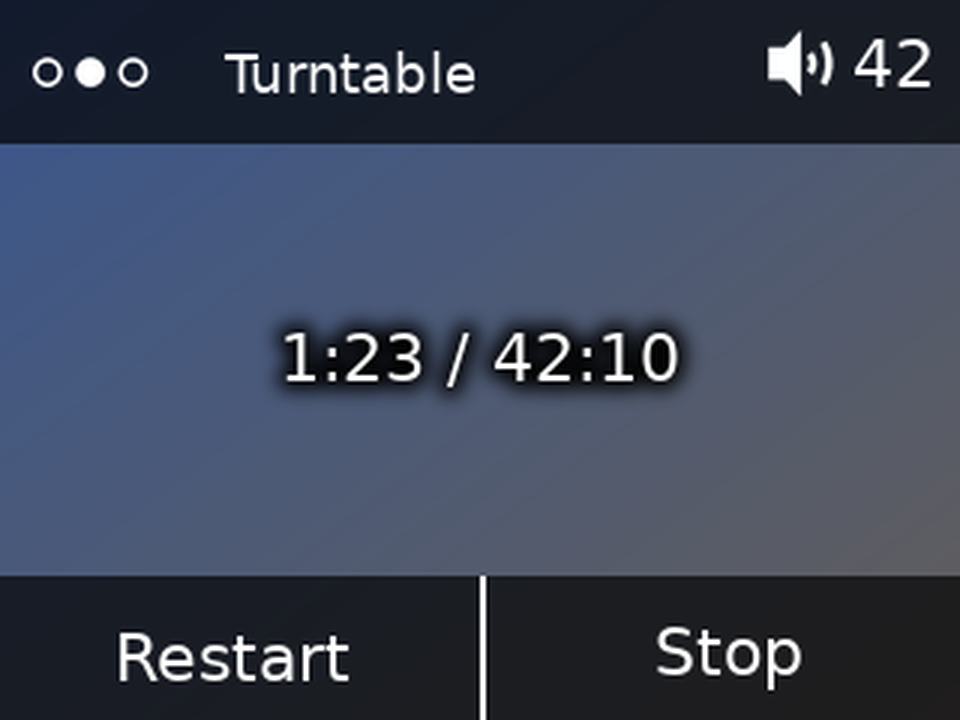

*Rich: the position counter ("elapsed / total") over Restart and Stop.
Restart seeks back to the beginning; Stop fades the replay out and returns
to Hold. The counter runs behind the appliance's reported position by the
appliance's audio start buffer (2 seconds when the appliance does not say),
so it reads 0:00 until sound has started and matches what you hear.*

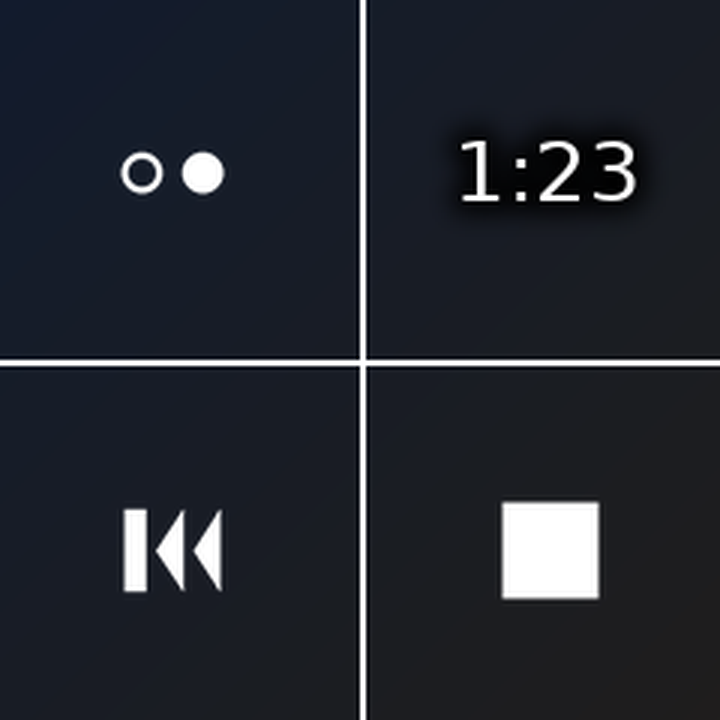

*Compact: its own 2x2, with the position counter top right, a
restart-to-start icon bottom left, and a stop square bottom right.*

### Replay picker

From the idle screen, tapping anywhere (when a replay is actually held)
opens a picker to choose which appliance's held recording to start from
the beginning:

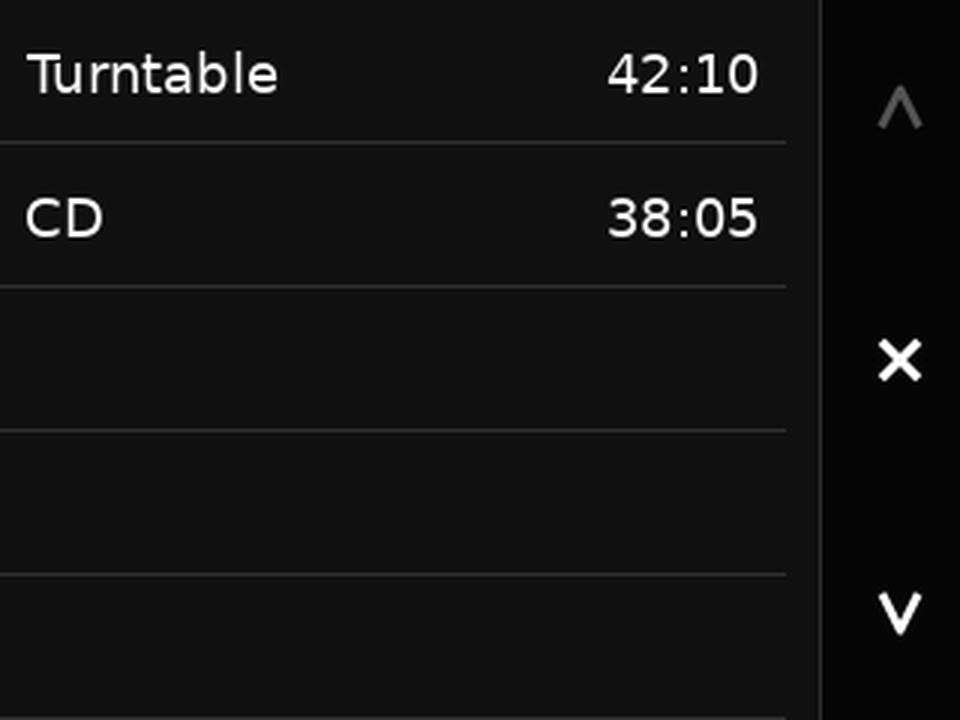

*Rich: the ordinary list chassis, reused. Each row shows an appliance name
and how much recording it's holding.*

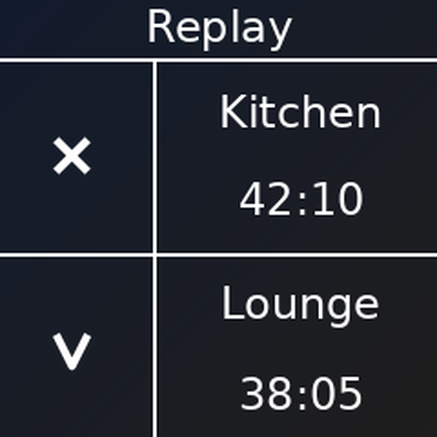

*Compact: its own smaller layout, with cancel (X) and "more" (next page,
wrapping) on the left, and the two visible rows on the right.*

Tapping a row starts that recording playing from the beginning straight
away and follows it on screen. On rich and larger panels the now-playing
screen shows the replay's position over the artwork for about ten seconds,
so you can see it has started, then fades it away.

## Per-output control

Rich panels only, and only for appliances that advertise support for it.
Opened by tapping the volume readout (the speaker icon and number, top
right of the now-playing, repeat or EQ page). Closing the list, or leaving
it alone until it times out, takes you back to the page you opened it
from:

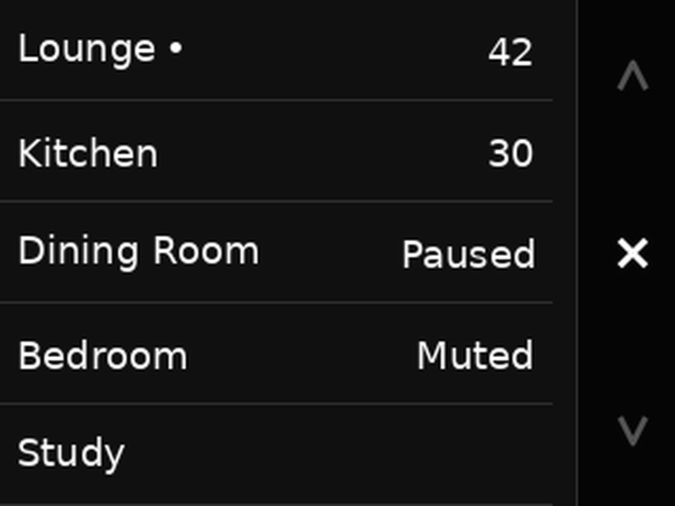

*The outputs list: a level number shows for whichever outputs are switched
on; nothing shows for ones that are off. The appliance's default output has
a bullet after its name.*

Tap a row to open that output's own detail page:

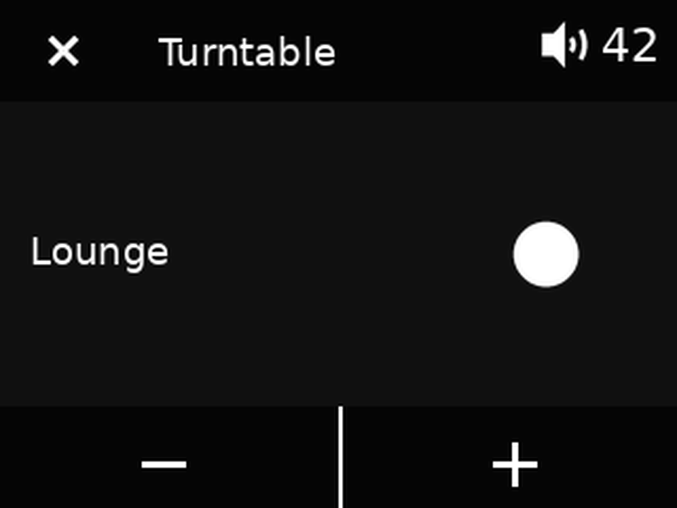

*The output's own toggle (solid dot = on) and its own minus/plus,
independent of the appliance's master volume shown top right.*

Tap the X (where the page dots normally sit) to go back to the list, or the
row itself to switch that output on or off. Compact panels have no volume
readout to tap, so this whole feature is unreachable there.

If a speaker needs pairing (a new Apple TV, for example), the page reads
**Pair in Autostream**: enter the PIN in the appliance's web UI, where the
prompt appears, then try again. Tap anywhere to go back. A speaker that asks
for its PIN a few seconds after you switch it on (an Apple TV often does)
shows the same page, on the speaker list or on any speaker's page of that
appliance.

If a speaker you switched on from the dial does not start, a page reads
**Could not start** with the speaker's name and a short reason. It shows only
on the main screen, the speaker list or a speaker's page, and never wakes a
sleeping screen. Tap anywhere to go back.

## EQ page

Rich and larger panels only, never available on compact, even for an
appliance that supports bass/treble control. Reached by cycling the page
dots to the third page:

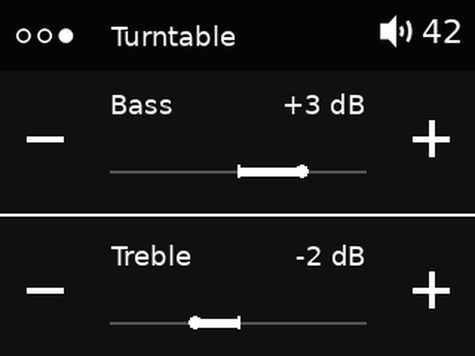

*Bass over Treble, each with its own reading in dB and its own minus/plus.
The master volume still shows top right, and tapping it opens the outputs
list as on the other two pages; there's no mute control on this page.*

## Info page

Opened by tapping the Wi-Fi icon in the top-left corner of the idle screen.
It shows a handful of read-only diagnostic fields about the dial itself, in
this order: the Wi-Fi network, its signal, the IP address, the dial's
configured name, the firmware version, free disk space, and the SD card's
remaining health, where monitoring is turned on. The HD dial's pull-down lists
the same fields in the same order.

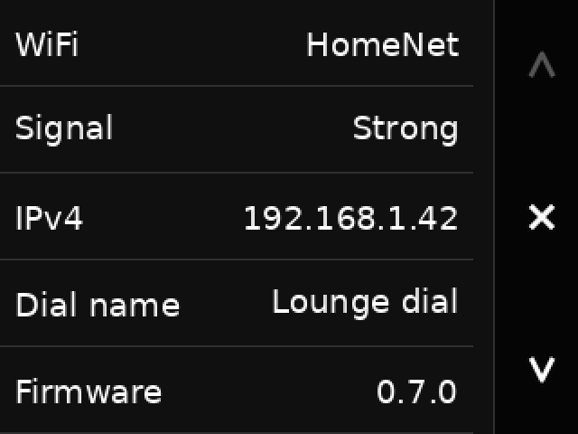

*Rich: a plain scrollable list, name and value together. Rows aren't
tappable here, there's nothing more to drill into.*

Compact shows names only, since there isn't room for both:

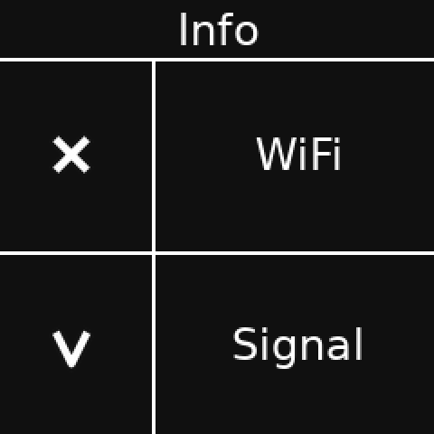

*Compact: field names only, in the same picker-shaped rows the replay
picker uses. Tap a row to see its value.*

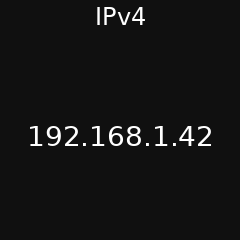

*The value drill-in a compact row opens: one field, full screen.*

Values fill in within about a second of opening the page; expect to see
placeholder dashes very briefly first. The page closes by itself after a
short while without a touch.

## The warning bell

When the dial has something to tell you, it shows a bell with a count. It
never opens a card on its own: a warning waits until you tap the bell. The
count includes the dial's own warnings (No WiFi, microSD card and **Update
this dial**) and the warnings of every appliance the dial lists, such as a
stylus near the end of its life. The bell's colour follows the most urgent of
them: blue for information, orange for a warning, red for a critical one. With
no warnings there is no bell.

Where the bell is drawn depends on what the screen is showing:

- **Idle:** in the top-right corner, opposite the Wi-Fi icon.

  

  *Idle with nothing to report: only the Wi-Fi icon.*

  

  *Idle with two warnings.*

- **Playing, with the controls shown:** in the top band beside the volume (the
  appliance name is shortened to make room). On the compact panel it sits beside
  the page dots.

  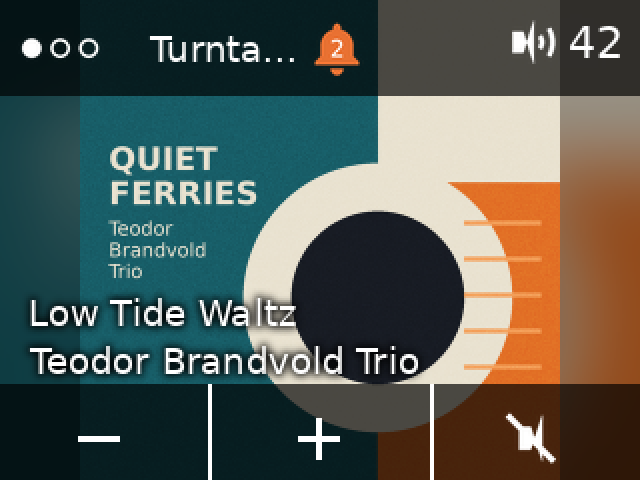

- **Playing, with the controls hidden:** on a dark disc in the top-right
  corner of the artwork. This is the one place where a first touch does more
  than bring the controls back: tapping the bell opens its card straight away.
  A tap anywhere else still reveals the controls first.

  

The knob still sets the volume whatever the screen is showing.

Tap the bell to open a card:

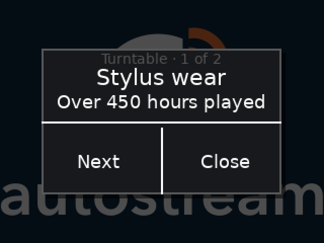

*One warning at a time. Small text at the top says where it comes from and
which of the bell's warnings this is ("Turntable · 1 of 2").*

- **Close** puts the card away. It does nothing else: nothing is hidden or
  postponed, and the bell keeps counting for as long as the cause is there. The
  card also closes by itself after a short while without a touch, and it does
  not keep the screen awake.
- **Next** shows the following warning and wraps round to the first after the
  last. It is only there when the bell holds more than one.
- A warning with an action of its own has it between these (**Restart** for No
  WiFi, below).

A warning leaves the bell when its cause goes. If the card is showing it at
the time, the card moves on to the next one, and closes if there is none. A
warning that starts while a card is open is not added to that card; it is in the
bell when you next open it. A card does not open while an update is showing or
the dial is restarting.

## No WiFi and Restart

When the dial has been connected since it last started and then loses the
network for a few seconds, it raises a **No WiFi** warning, and the Wi-Fi icon
flashes (see [above](#wi-fi-status-icon)). Open the bell to read it. If the
dial has not connected at all since it started, for example straight after a
reboot, there is no warning: it may simply not have joined yet.

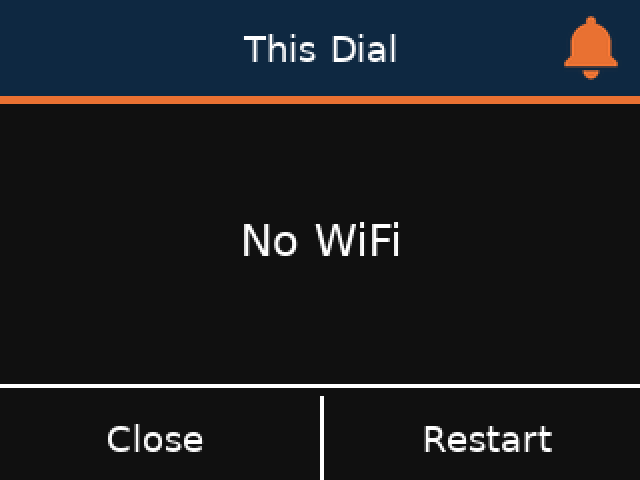

*Rich: the card fills the panel on a plain dark background.*

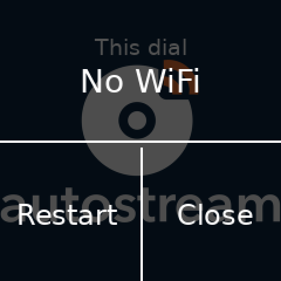

*Compact: the same card and buttons.*

**Close** puts the card away; the bell stays while the dial is off the
network. Getting back on the network clears the warning by itself.

**Restart** reboots the dial. It shows "Restarting..." immediately and asks
for the reboot in the background. If the network has come back by the time you
tap it, the warning has gone and nothing restarts.

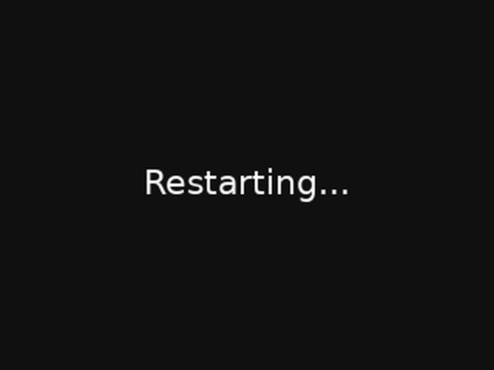

*Shown from the moment you tap Restart until the reboot actually takes the
screen down. Identical on every tier.*

## SD card warning

Shown in the bell when SD card health monitoring is turned on (from the
appliance's Setup page) and the card's remaining endurance drops low. The card
has a title, a body line with the remaining percentage and a **Close** button.
The wording is the same as on the appliance: "replace soon" below 20 percent,
and under 10 percent the warning counts as critical, reads "replace now" and the
bell turns red.

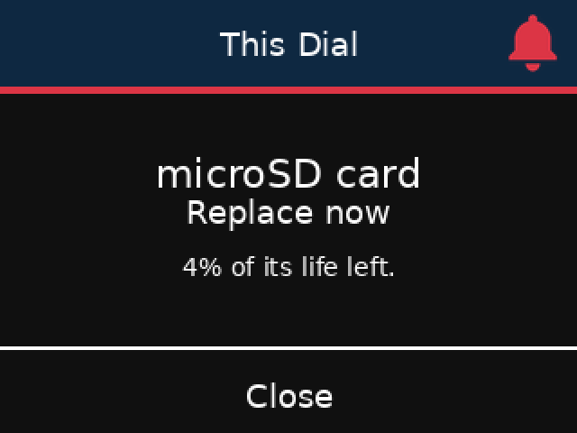

**Close** puts the card away and does nothing more; the warning stays in the
bell until the reading recovers. Like every warnings card it closes by itself
after a short while without a touch. The current reading is also on the
[Info page](#info-page).

## Appliance warnings

An autostream appliance can ask the dial to show a warning of its own. The
appliance sends these for maintenance and power: a stylus near or past the end
of its life, a drive belt or main bearing due for service, or a power supply
that has dipped below its voltage. They are counted in the dial's bell and shown
on the same card as the others: the appliance's name in small text on top
(with the warning's place, "1 of 2", when there is more than one), then a title
(for example "Stylus wear"), a short message (for example "Over 450 hours
played") and **Close**, with **Next** when the bell holds more than one.

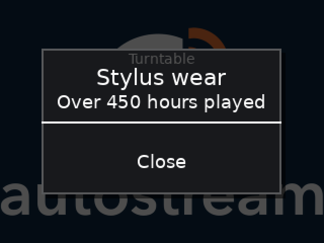

- A warning never wakes a sleeping panel and never opens by itself.
- It leaves the bell when the appliance stops reporting it, for instance after
  you reset the counter in its Service page.
- **Close** hides nothing. While the cause is there, the bell keeps counting it.

**Update this dial** is the dial's own warning, shown in the same way. Its
message names the appliances that run newer software than the dial, for example
"Turntable, CD Player need a newer dial". It is one entry however many
appliances are ahead of the dial. Update the dial from the appliance's web UI;
the dial keeps working with those appliances in the meantime.

## Software update

When the dial updates its own software (see
[System Maintenance](SYSTEM-MAINTENANCE.md#firmware-updates)), a card
appears on the screen. It can come up over whatever is showing, including a
list, and it wakes a sleeping panel. Touching the screen does nothing while
it shows, but turning the volume control and pressing it still work as normal.

**Updating...** is the card while the update runs. It has a progress bar and,
under it, a short label for the current step: **Downloading**, **Upgrading
OS**, **Installing** or **Restarting**. The bar moves forward as the update
does. If the update is retried after an interruption, the bar starts again
from the start.

When the update reaches its restart, the card gives way to the same
**Restarting...** screen that a restart from the No WiFi card uses. The panel
then goes dark while
the dial reboots, and shows **Starting...** when it comes back. While the new
version is being checked the screen carries on as normal.

Then a result card tells you how it went:

- **Updated**, with **Version <number>** under it, if the new version passed
  its check.
- **Update failed**, with **Restored <old number>** under it if the new version
  failed its check and the dial went back to the old one, or **<old number>
  kept** if the update stopped before anything was replaced.

The result card has one **Close** button. If nobody closes it, it clears
itself after an hour, since an update can take about 40 minutes and may well
be left unattended. A result is shown once: it does not come back after
Close, after it clears itself, or after the dial restarts.

These cards are the only ones that open by themselves, because they say what
the dial is doing. Warnings never do; they wait in the [bell](#the-warning-bell).

If the dial has no screen, none of this applies; follow the update from the
appliance's Dials panel instead.

## Gaps I couldn't confirm from the code

- `[ ]` I couldn't confirm from the dial's own source whether a screen
  fitted without a touch panel can ever reach the repeat, EQ, outputs or
  info pages some other way (for example, automatically cycling). I've
  assumed here that all of those need a touch panel to open, since every
  route into them in the code is a tap.
- `[ ]` The EQ page is also available on a "large" physical panel tier, one
  step up from the rich panels shown here. I haven't rendered a screenshot
  for that tier specifically; the rich screenshots above should still be
  representative, just smaller than the large panel would show it.

## Next steps

- [Getting Started](GETTING-STARTED.md): setting the dial up in the first
  place, from the appliance's own web interface.
- [Build Guide](BUILD-GUIDE.md): fitting the screen and touch panel.
- [HD dial](HD-DIAL.md): a dial with a full-size touchscreen.
- [System Maintenance](SYSTEM-MAINTENANCE.md): firmware updates and
  recovering a dial that won't come back online.
