# autostream dial: Using the Screen

This guide covers the optional dial screen: what each page shows, what
happens when you tap it, and how the pages fit together. It doesn't cover
setup or configuration; see [Getting Started](GETTING-STARTED.md) for
that, and the [Build Guide](BUILD-GUIDE.md) for fitting the screen and
touch panel in the first place.

The screen comes in two sizes. A small (physically tiny) panel runs a
simplified "compact" layout: a plain 2x2 grid of controls with no text
labels beyond what's strictly needed. A larger panel runs the full "rich"
layout, with an appliance name, artist and track text, and a few extra
pages the compact layout doesn't have room for. Screenshots below are
marked rich or compact; where a page looks the same either way, only one is
shown.

Everything in this guide needs the touch panel to interact with. A screen
fitted without a touch panel still shows the same pages, but taps do
nothing: turn the dial's rotary control to change volume, as before.

`[ ]` marks a couple of points I couldn't confirm from the code and have
flagged rather than guessed.

## Idle screen

Nothing playing, on any autostream appliance the dial can see, shows the
plain autostream logo:

*Rich idle screen: logo, Wi-Fi icon (top left), info badge (top right).*

*Compact idle screen: the same logo, icon and badge, just tighter.*

Two small corner controls sit on every idle screen, rich or compact:

- **Top right, the "i" badge** opens the [info page](#info-page). It's
  always there, whether or not anything is playing.
- **Top left, the Wi-Fi icon** shows the dial's own network status (see
  below) and opens the [No-WiFi page](#no-wifi-and-restart) when the link
  is down.

Tapping anywhere else on the idle screen opens the replay picker, but only
if a held recording is actually available to replay; otherwise the tap
does nothing. See [Repeat and replay](#repeat-and-replay).

## Wi-Fi status icon

The Wi-Fi icon in the top-left corner has four looks:

*Connected: steady bars, one lit for each notch of signal strength.*

The icon flashes when the link is down, alternating every second or so
between a dimmed grey glyph and one of two other looks, depending on what
kind of "down" it is:

*The grey half of the flash, shown either way while the link is down.*

*Lost connection: the flash's other half turns red. This means the dial
was connected at some point since it last started, and has since dropped
off the network.*

*Still connecting: the flash's other half shows nothing at all, rather
than red. This means the dial hasn't connected since it started up (for
example, straight after a reboot), so dropping to red would wrongly
suggest something has gone wrong, when it may simply not have joined yet.*

The distinction matters for what a tap on the icon does. While the dial is
still connecting (grey/blank), a tap opens the No-WiFi page, but nothing
opens it for you: you have to go looking. Once the dial has been connected
and then loses the link (grey/red), the No-WiFi page opens on its own after
a few seconds of being down, without you needing to tap anything. See
[No-WiFi and Restart](#no-wifi-and-restart).

## Starting up

The very first frame the screen shows at boot, before the dial has even
finished starting its own backend:

*Rich panel.*

*Compact panel: identical message, smaller frame.*

This clears itself automatically once the dial's first status check
completes, replaced by the idle screen or whatever is playing.

## Now playing and touch controls

While something is playing, the appliance name, artist, track and volume
show at the top and bottom of the artwork. Artwork, artist and track shown
here are stand-ins, not a real recording:

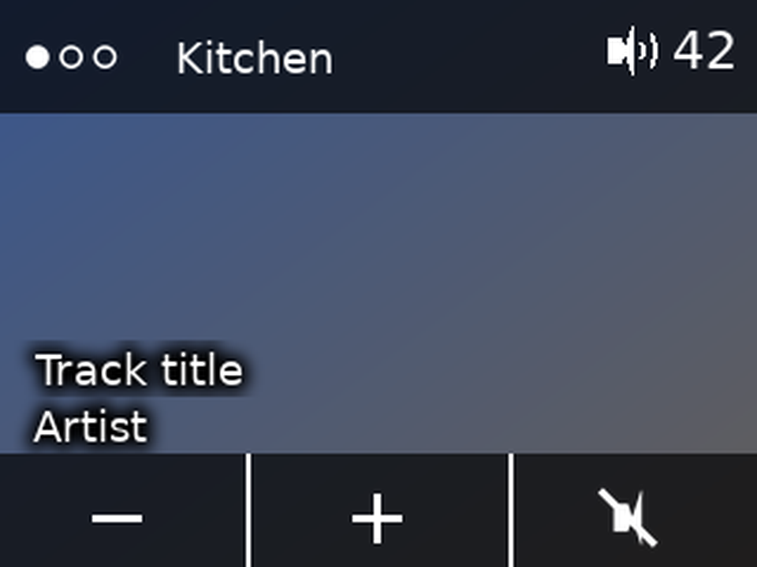

*Rich now-playing screen. Top: page dots, appliance name, speaker icon and
volume. Bottom: minus, plus, mute.*

The top and bottom bands here are two different tap targets that happen to
both show a speaker icon, easy to mix up:

- The **top-right speaker icon and volume number** open the
  [outputs list](#per-output-control) (rich panels only, see below).
- The **bottom-right mute button** toggles mute. It always shows the same
  crossed-speaker icon; when muted, the whole button lights up solid so you
  can see the state at a glance, rather than the icon itself changing.

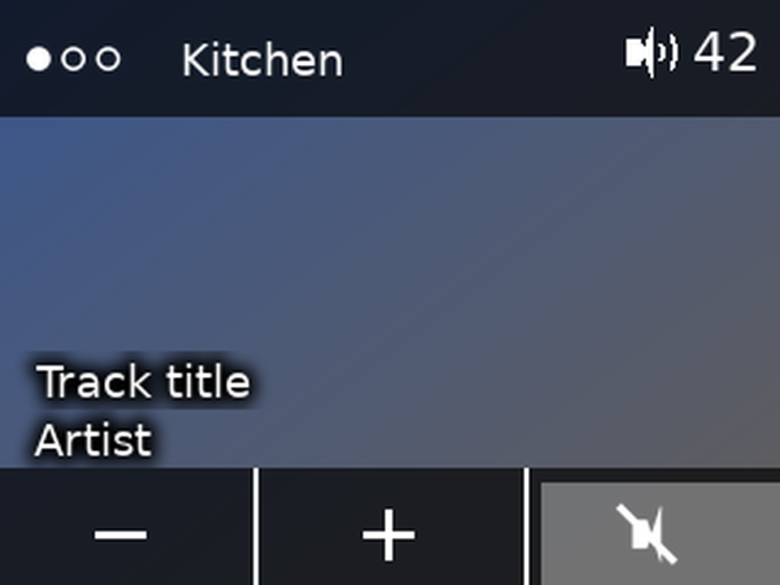

*Muted: the mute cell (bottom right) fills solid. Nothing else changes:
the appliance is still selected and playing, just silent.*

Tapping the artwork itself (the middle of the screen, between the two
bands) hides both bands for about six seconds, so you can see the artwork
without anything overlaid. Tap anywhere on the screen to bring the bands
back before the six seconds is up.

Other taps on this screen:

- The **appliance name** (top left, next to the page dots) opens the
  [appliance selector](#appliance-selector), rich panels only.
- **Minus** and **plus** (bottom left and centre) step the volume down or
  up by the configured step size. Hold either down to repeat.

### Compact controls

On a compact panel, the now-playing screen has no text at all, just
artwork behind a 2x2 grid of controls, and even that grid starts hidden.
Tap anywhere to reveal it for about six seconds:

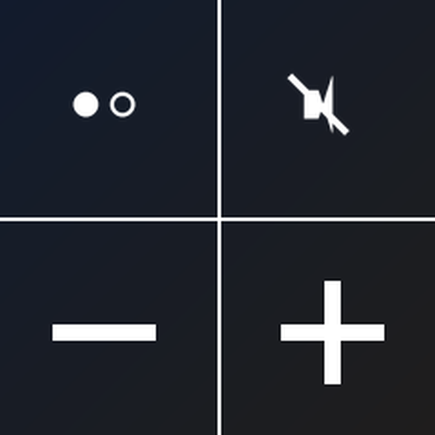

*Compact controls, revealed. Top left: page dots. Top right: mute. Bottom:
minus, plus.*

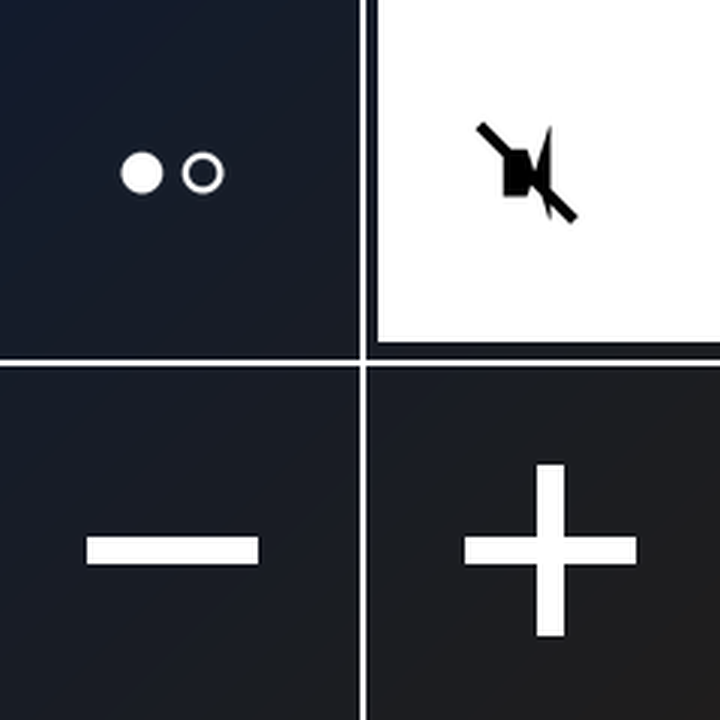

*Muted: the top-right cell inverts to a solid light background with a dark
glyph, the same "always the same icon, the cell shows the state" rule as
the rich mute button.*

There's no appliance name and no way to open the outputs list from a
compact panel; see the notes on each of those sections below.

## Page dots

The two or three small dots next to the appliance name (or, on compact, on
their own in the top-left cell) show which of up to three pages is open,
and let you move between them:

- **Main** (now playing): the left dot.
- **Repeat**: the middle dot, only present if a held recording is
  available to arm or replay.
- **EQ**: the third dot, only present on rich and larger panels, and only
  if the currently-followed appliance supports bass/treble control. Never
  appears on compact panels at all, even if the appliance supports it.

Tapping the dots cycles to the next available page, skipping any page with
nothing to show, and wrapping back to main. Leaving the repeat or EQ page
this way brings you back to the now-playing screen with its volume overlay
showing, rather than bare artwork.

## Appliance selector

Rich panels only. Tapping the appliance name opens a list of every
appliance the dial can see and control:

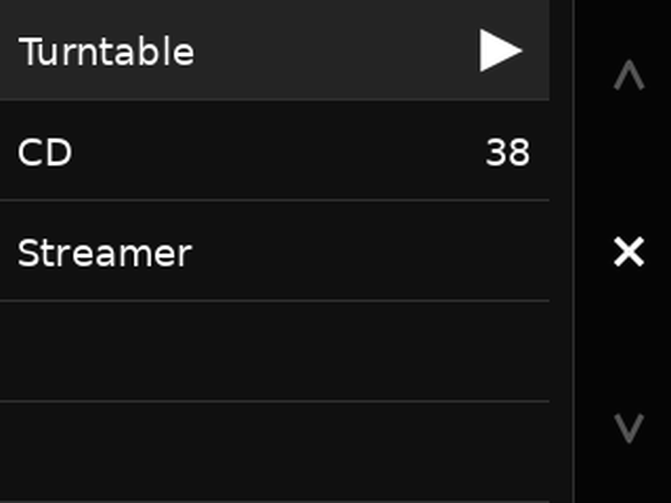

*The currently-playing row (highlighted) shows a play glyph; other rows
show their own volume if idle, or nothing if unreachable.*

Tap a row to switch the dial's focus to that appliance. This works whether
it's currently playing or idle. Tap the X to close the list without
changing anything. The chevrons (or, on some panels, a side rail) page
through the list if there are more appliances than fit on one screen.

Compact panels have no name button and so no way to open this list: a
compact dial simply follows whichever appliance is currently reporting
playback.

## Repeat and replay

The repeat feature holds a recording so it can be replayed later. Before
one is running or held, the repeat page doesn't exist at all: the page
dots skip straight over it. Once a recording is available, it has two
layouts depending on state.

### Enable

Shown while a live source is recording, pending, or idle with repeat
switched on:

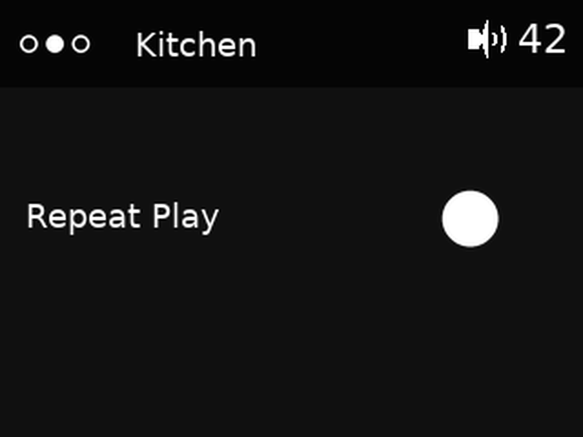

*Rich: the toggle row. A solid dot means armed; a hollow ring means
disarmed. Tap the row to flip it.*

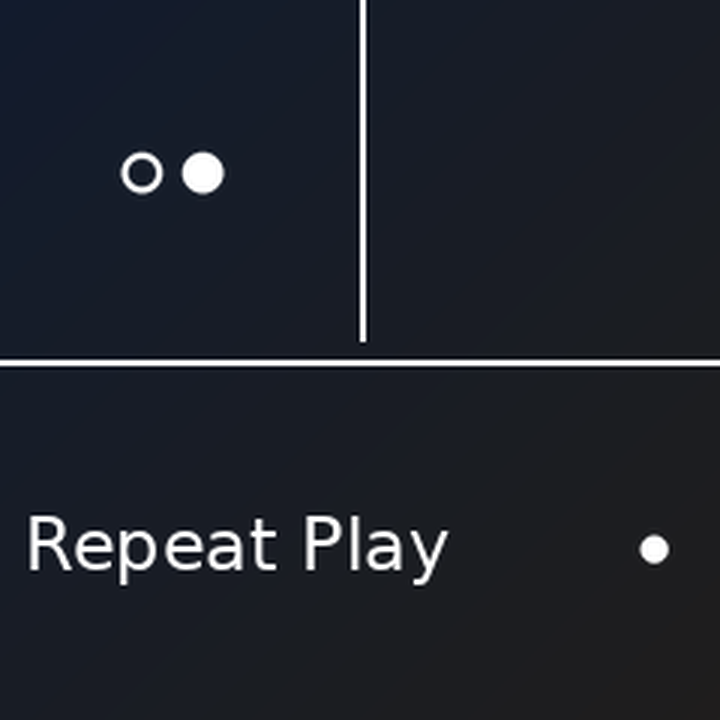

*Compact: the same toggle spans the whole bottom row, with the dots cell
top left to back out.*

### Replaying

Shown once a held recording is running (or paused in Hold, ready to
start):

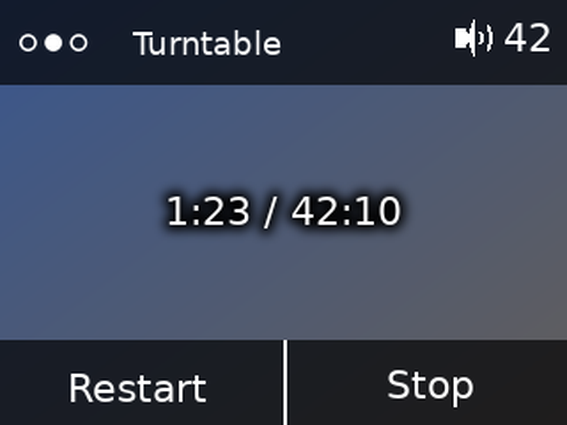

*Rich: the position counter ("elapsed / total") over Restart and Stop.
Restart seeks back to the beginning; Stop fades the replay out and returns
to Hold.*

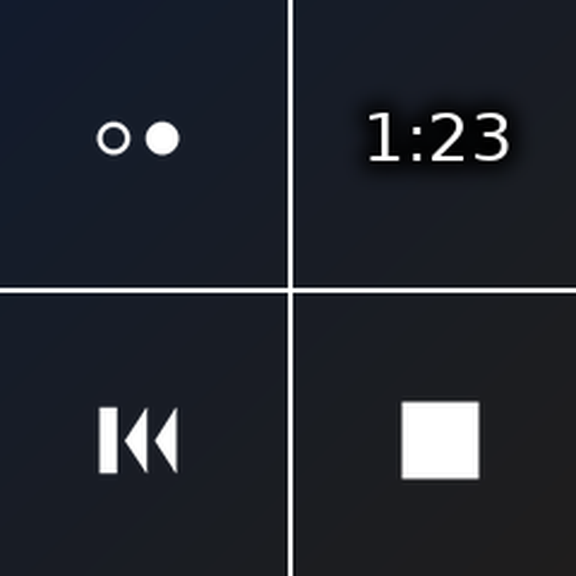

*Compact: its own 2x2, with the position counter top right, a
restart-to-start icon bottom left, and a stop square bottom right.*

### Replay picker

From the idle screen, tapping anywhere (when a replay is actually held)
opens a picker to choose which appliance's held recording to start from
the beginning:

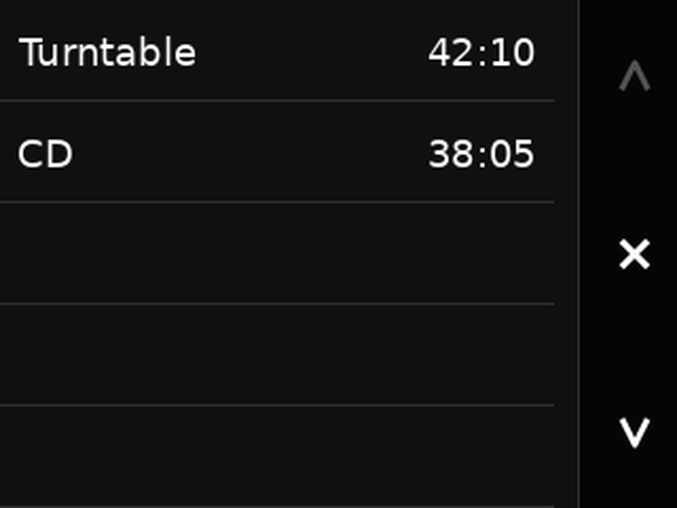

*Rich: the ordinary list chassis, reused. Each row shows an appliance name
and how much recording it's holding.*

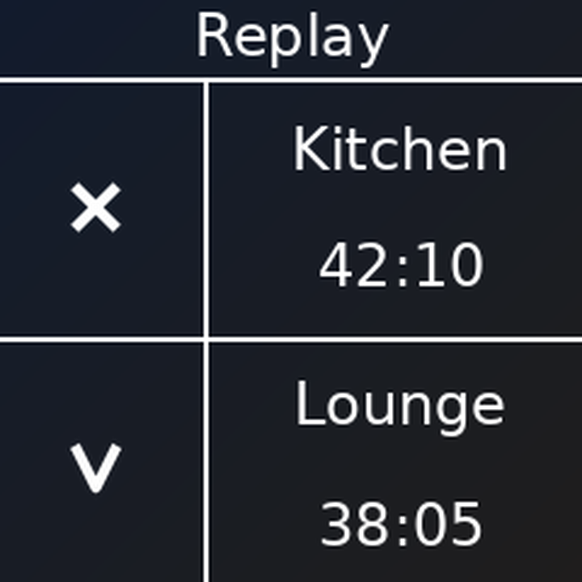

*Compact: its own smaller layout, with cancel (X) and "more" (next page,
wrapping) on the left, and the two visible rows on the right.*

Tapping a row starts that recording playing from the beginning straight
away and follows it on screen.

## Per-output control

Rich panels only, and only for appliances that advertise support for it.
Opened by tapping the volume readout (the speaker icon and number, top
right of the now-playing or repeat screen):

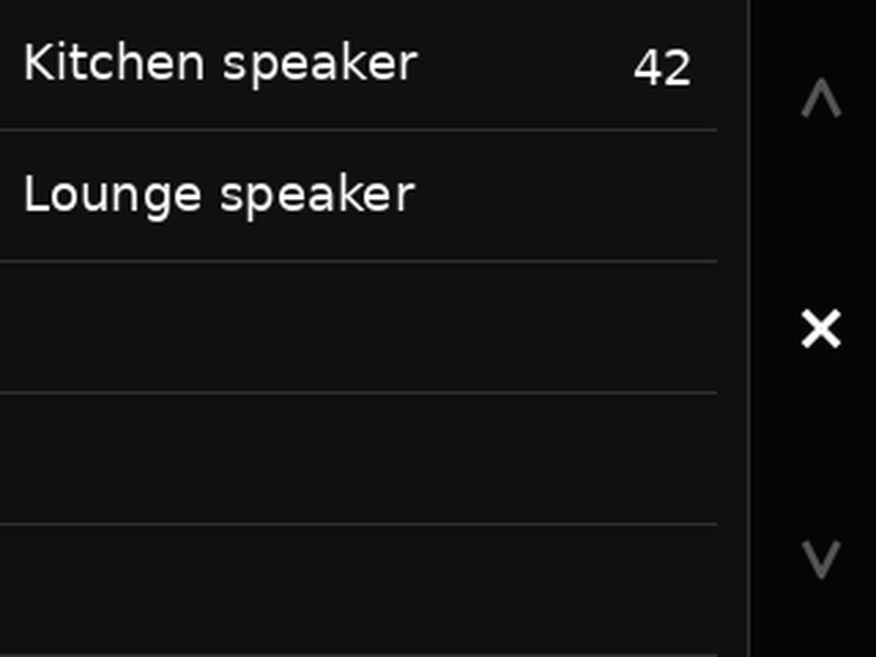

*The outputs list: a level number shows for whichever outputs are switched
on; nothing shows for ones that are off.*

Tap a row to open that output's own detail page:

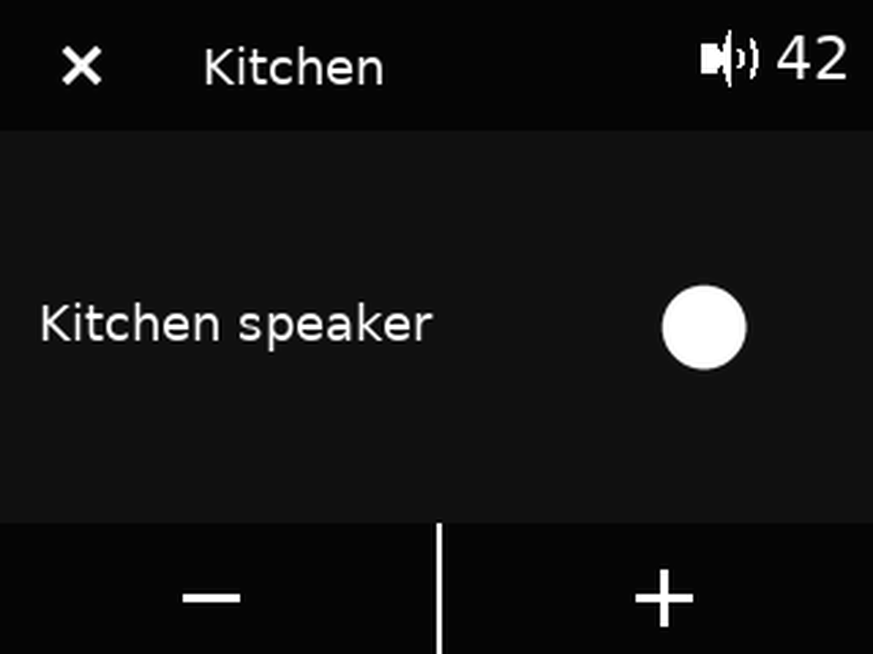

*The output's own toggle (solid dot = on) and its own minus/plus,
independent of the appliance's master volume shown top right.*

Tap the X (where the page dots normally sit) to go back to the list, or the
row itself to switch that output on or off. Compact panels have no volume
readout to tap, so this whole feature is unreachable there.

## EQ page

Rich and larger panels only, never available on compact, even for an
appliance that supports bass/treble control. Reached by cycling the page
dots to the third page:

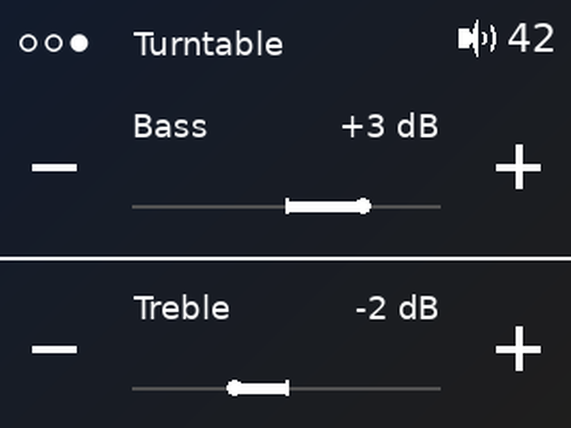

*Bass over Treble, each with its own reading in dB and its own minus/plus.
The master volume still shows top right; there's no mute or outputs
control on this page.*

## Info page

Reachable from the idle screen's "i" badge on every tier. Shows a handful
of read-only diagnostic fields about the dial itself: its configured name,
firmware version, IP address, Wi-Fi network and signal, free disk space,
and its SD card's remaining health, where monitoring is turned on.

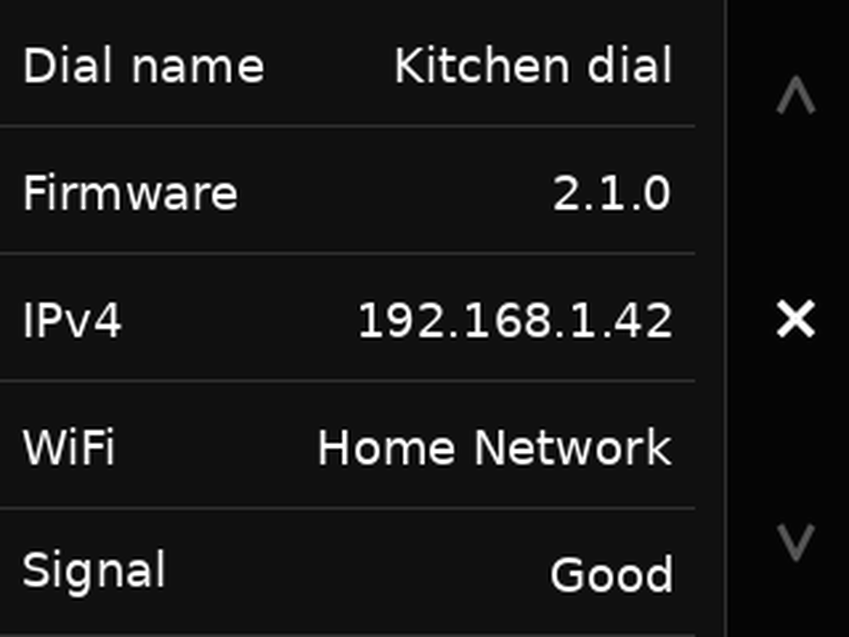

*Rich: a plain scrollable list, name and value together. Rows aren't
tappable here, there's nothing more to drill into.*

Compact shows names only, since there isn't room for both:

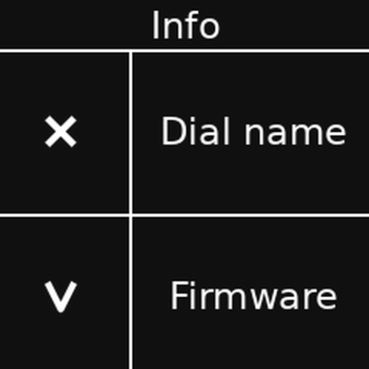

*Compact: field names only, in the same picker-shaped rows the replay
picker uses. Tap a row to see its value.*

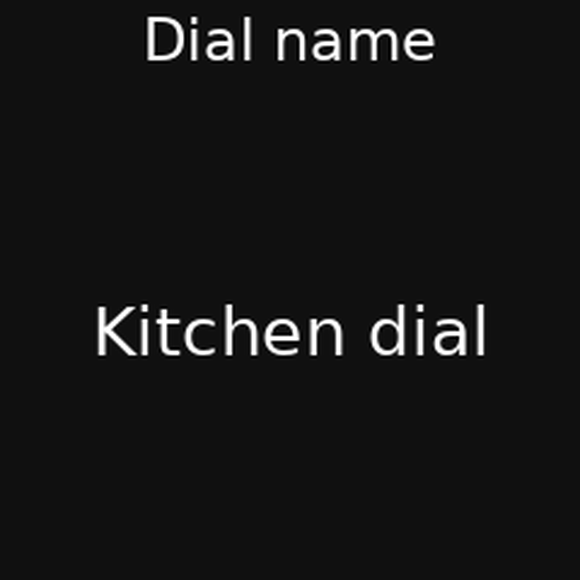

*The value drill-in a compact row opens: one field, full screen.*

Values fill in within about a second of opening the page; expect to see
placeholder dashes very briefly first.

## No-WiFi and Restart

Opened by tapping the flashing Wi-Fi icon on the idle screen, or on its own
once the link has been down for a few seconds, but only if the dial has
connected at some point since it last started. If it's still connecting
for the first time, the page waits for you to tap the icon rather than
opening itself.

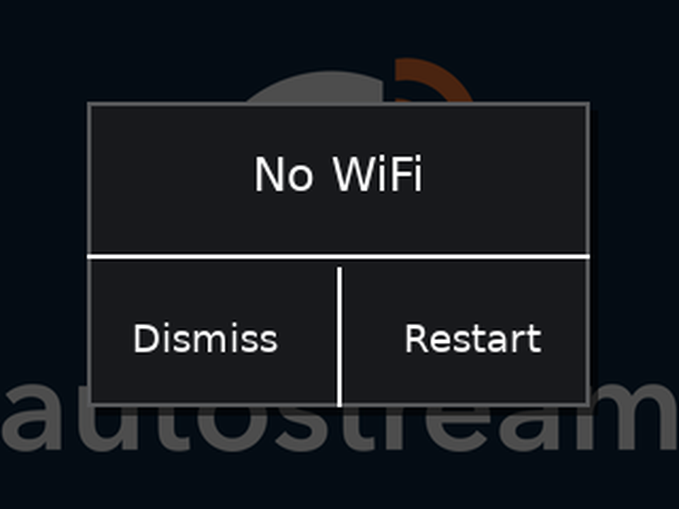

*Rich: a modal card over the dimmed idle screen.*

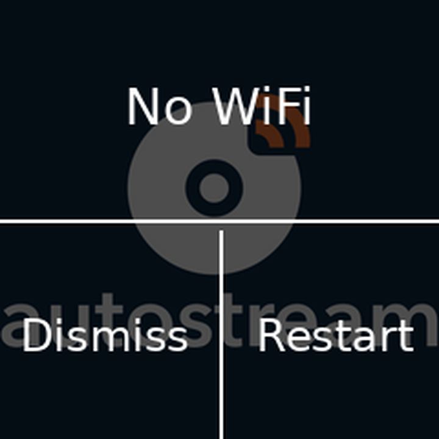

*Compact: the same Dismiss/Restart layout, filling the panel instead of a
card.*

**Dismiss** closes the page without doing anything else. It stays closed
for the rest of this outage: the icon keeps flashing, and a tap on it
reopens the page if you change your mind. Reconnecting closes it
automatically and resets Dismiss for next time.

**Restart** reboots the dial. It shows "Restarting..." immediately and asks
for the reboot in the background:

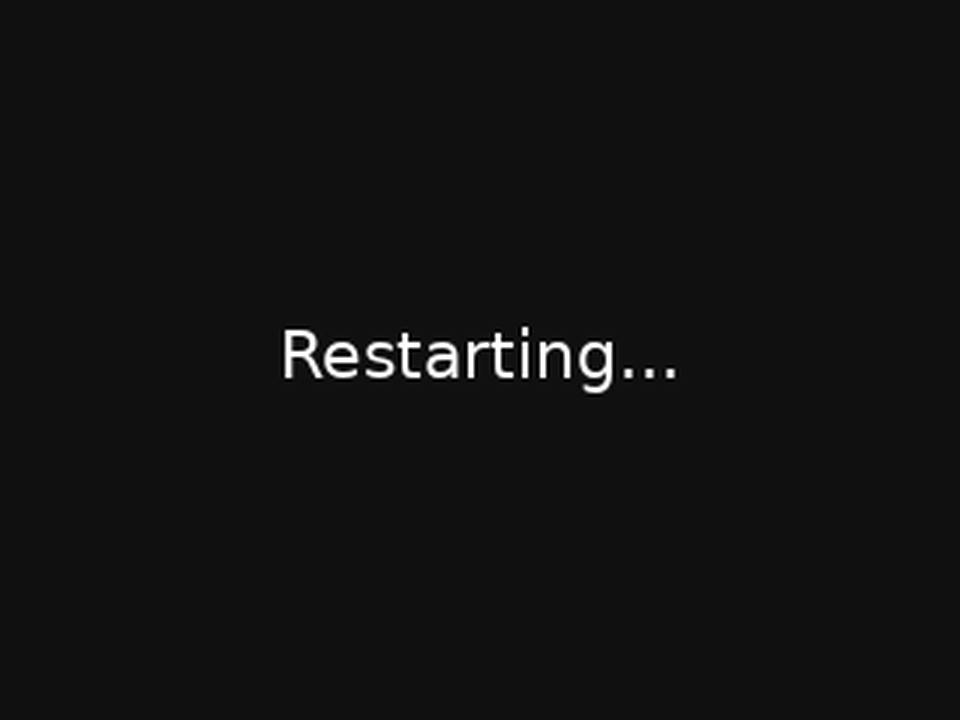

*Shown from the moment you tap Restart until the reboot actually takes the
screen down. Identical on every tier.*

## SD card warning

Shown when SD card health monitoring is turned on (from the appliance's
Setup page) and the card's remaining endurance drops low. Like the No-WiFi
page, it can appear over now-playing as well as the idle screen, and looks
the same way on both tiers: a title, a body line with the remaining
percentage, and one **Dismiss** button spanning the width of the card.

**Dismiss** closes the warning without doing anything else. It stays closed
until the reading recovers or the dial restarts; if you don't tap it at
all, the page closes on its own after a minute so it never sits over
now-playing indefinitely. Either way, the current reading stays visible on
the [info page](#info-page).

## Gaps I couldn't confirm from the code

- `[ ]` I couldn't confirm from the dial's own source whether a screen
  fitted without a touch panel can ever reach the repeat, EQ, outputs or
  info pages some other way (for example, automatically cycling). I've
  assumed here that all of those need a touch panel to open, since every
  route into them in the code is a tap.
- `[ ]` The EQ page is also available on a "large" physical panel tier, one
  step up from the rich panels shown here. I haven't rendered a screenshot
  for that tier specifically; the rich screenshots above should still be
  representative, just smaller than the large panel would show it.

## Next steps

- [Getting Started](GETTING-STARTED.md): setting the dial up in the first
  place, from the appliance's own web interface.
- [Build Guide](BUILD-GUIDE.md): fitting the screen and touch panel.
- [System Maintenance](SYSTEM-MAINTENANCE.md): firmware updates and
  recovering a dial that won't come back online.
